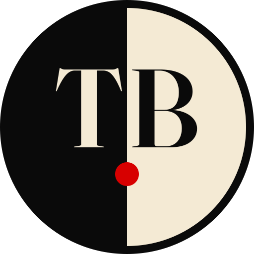
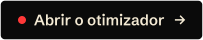
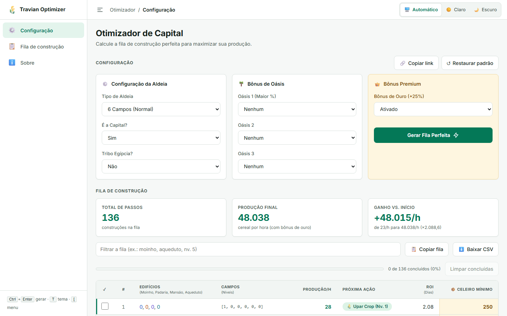
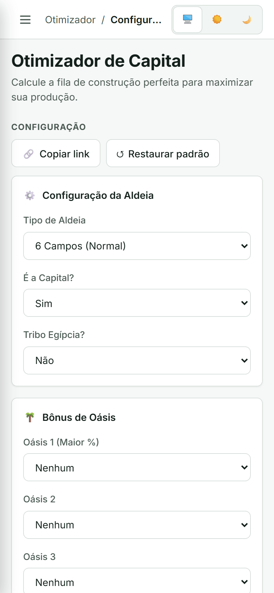

<a id="top"></a>

<div align="center">

<picture>
  <source media="(prefers-color-scheme: dark)" srcset="https://raw.githubusercontent.com/voaneves/travian-building-order/main/assets/logo/logo-dark.svg" />
  <source media="(prefers-color-scheme: light)" srcset="https://raw.githubusercontent.com/voaneves/travian-building-order/main/assets/logo/logo-light.svg" />
  
</picture>

<h1>Travian Building Order</h1>

<p>
  <strong>Calcula a ordem de construção que mais rende cereal para a sua aldeia no Travian.</strong><br />
  <sub>Otimizador em HTML e JavaScript puros, direto no navegador</sub>
</p>

<p>
  <a href="https://voaneves.github.io/travian-building-order/"><picture><source media="(prefers-color-scheme: dark)" srcset="https://raw.githubusercontent.com/voaneves/travian-building-order/main/assets/buttons/live-dark.svg" /></picture></a>
  <a href="#como-começar"><picture><source media="(prefers-color-scheme: dark)" srcset="https://raw.githubusercontent.com/voaneves/travian-building-order/main/assets/buttons/run-dark.svg" /></picture></a>
</p>

<p><sub>Precisa de algo assim? <a href="https://voaneves.com/#contato"><strong>Vamos conversar →</strong></a></sub></p>

<p>
  <a href="https://github.com/voaneves/travian-building-order/blob/main/LICENSE"></a>
  
</p>

<p>
  <a href="https://voaneves.github.io/travian-building-order/">Demo</a> ·
  <a href="#sobre-o-projeto">Sobre</a> ·
  <a href="#metodologia">Metodologia</a> ·
  <a href="#como-começar">Como começar</a> ·
  <a href="#contato">Contato</a>
</p>

</div>

<picture>
  <source media="(prefers-color-scheme: dark)" srcset="https://raw.githubusercontent.com/voaneves/travian-building-order/main/assets/brand/rule-dark.svg" />
  <source media="(prefers-color-scheme: light)" srcset="https://raw.githubusercontent.com/voaneves/travian-building-order/main/assets/brand/rule-light.svg" />
  
</picture>

## Sobre o projeto

O Travian Building Order calcula a fila de construção da sua aldeia no Travian para maximizar a produção de cereal, no lugar de adivinhar a ordem das obras.

<p align="center">
  <a href="https://voaneves.github.io/travian-building-order/"></a>
  <a href="https://voaneves.github.io/travian-building-order/"></a>
</p>

**Demo:** <https://voaneves.github.io/travian-building-order/>

### Pontos principais

- **Configuração personalizada:** suporta oásis, bônus premium e o Aqueduto dos Egípcios.
- **Retorno sobre o investimento:** o algoritmo busca o menor tempo de retorno para cada ação.
- **Ação direta:** além dos níveis, mostra o Celeiro mínimo exigido para a próxima obra.
- **Produtividade:** salva a configuração, gera link compartilhável, marca passos concluídos, filtra a fila e exporta em CSV ou texto (TSV).
- **Navegação:** menu lateral recolhível com vistas por rota (`#/config`, `#/fila`, `#/sobre`), gaveta no celular e layout de 320px a ultrawide.
- **Acessibilidade:** tema automático, claro ou escuro, alto contraste, tamanho e espaçamento de texto, fonte legível, redução de animações e foco reforçado, além de atalhos de teclado (Ctrl+Enter, T, [).

### Tecnologias

- **HTML5 e JavaScript puro:** lógica de cálculo sem frameworks.
- **CSS próprio:** layout responsivo com CSS Grid e variáveis CSS (tema claro/escuro), sem frameworks nem build.
- **Inter:** fonte pensada para a leitura dos dados.

## Estrutura do projeto

- `index.html`: aplicação completa, com interface e lógica.
- `docs/img/`: capturas de tela usadas neste README.
- `LICENSE`: licença.

## Metodologia

### Antes (AS IS)

Sem a ferramenta, o jogador precisa de planilhas ou de contas à mão para saber se vale mais evoluir um campo de cereal ou o Moinho, com custos crescentes e bônus multiplicativos.

### Depois (TO BE)

1. **Parâmetros:** o usuário define o cenário base (tipo de aldeia, capital, oásis).
2. **Eficiência:** o script avalia as ações imediatas (Moinho, Padaria, Mansão, Aqueduto e campos).
3. **Decisão:** o algoritmo escolhe a ação com o menor custo por ponto de produção gerado.
4. **Ciclo:** repete até todos os campos chegarem ao nível máximo ou à condição de parada da aldeia.

## Desafios e soluções

### Complexidade dos bônus

- **Problema:** bônus de oásis, premium (ouro) e edifícios (Moinho/Padaria) interagem de forma multiplicativa, o que torna o cálculo de ROI dinâmico.
- **Solução:** custos e produções ficam em matrizes fixas no JavaScript, e funções independentes (`totalprodn`) simulam o cenário exato antes de decidir "comprar" o nível.

### Experiência de uso

- **Problema:** uma tabela com 20 ou 30 passos é cansativa de ler.
- **Solução:** cores nos ícones e destaques nas ações (verde para campos, azul para Moinho), para o jogador ler, aplicar e voltar ao jogo rapidamente.

## Resultados

1. **Decisão baseada em dados:** mostra quando anexar um oásis com a Mansão do Herói compensa mais do que evoluir um campo de cereal nível 10+.
2. **Planejamento:** a coluna "Celeiro Mínimo" evita que a fila trave por falta de capacidade de armazenamento.

## Como começar

1. Clone o repositório:

   ```bash
   git clone https://github.com/voaneves/travian-building-order.git
   ```

2. Abra o `index.html` no navegador.
3. Configure os parâmetros da sua aldeia no painel superior.
4. Clique em **Gerar Fila Perfeita** e siga a tabela de construção.

## A fazer

- [ ] Incluir suporte a heróis com bônus de produção de recursos
- [x] Exportar a tabela gerada para CSV ou texto (TSV)
- [x] Modo escuro

## Reportando bugs

Encontrou um problema nos cálculos ou na interface? Veja se já foi relatado nas [issues](https://github.com/voaneves/travian-building-order/issues). Se não, abra uma nova com um título claro e os passos para reproduzir (por exemplo, os níveis de oásis selecionados), e capturas de tela se possível. Pull requests são bem-vindos.

## Licença

Este projeto é licenciado sob a [MIT License](https://github.com/voaneves/travian-building-order/blob/main/LICENSE).

## Contato

<p>
  <a href="https://voaneves.com/#contato"><picture><source media="(prefers-color-scheme: dark)" srcset="https://raw.githubusercontent.com/voaneves/travian-building-order/main/assets/buttons/hire-dark.svg" /></picture></a>
  <a href="https://voaneves.com/"><picture><source media="(prefers-color-scheme: dark)" srcset="https://raw.githubusercontent.com/voaneves/travian-building-order/main/assets/buttons/site-dark.svg" /></picture></a>
</p>

<a href="https://linkedin.com/in/voaneves">LinkedIn</a> · <a href="mailto:victorneves478@gmail.com">E-mail</a>

<p align="center">
  
</p>

<p align="center"><sub>Distribuído sob a <a href="https://github.com/voaneves/travian-building-order/blob/main/LICENSE">licença MIT</a>.</sub></p>

<p align="center"><sub><a href="#top">↑ Voltar ao topo</a></sub></p>
